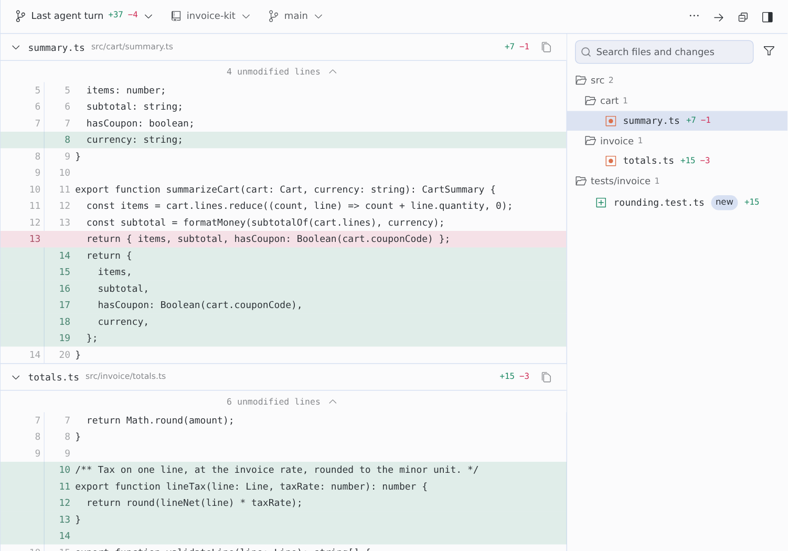
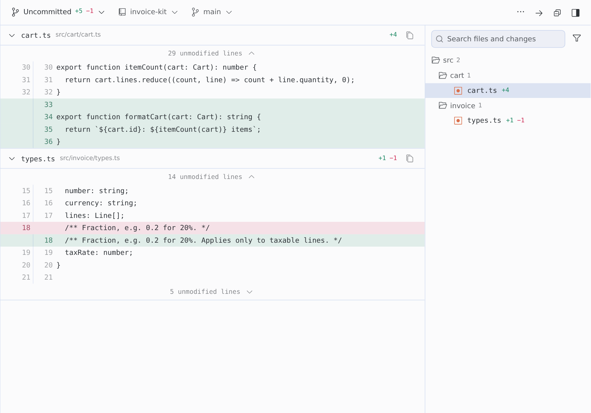
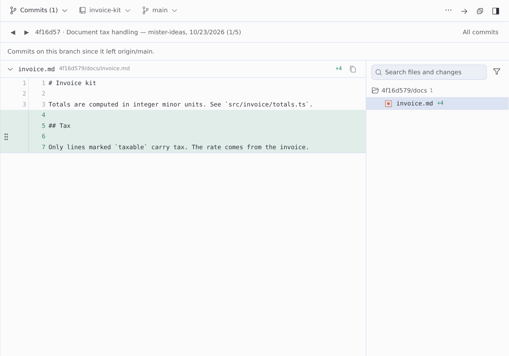
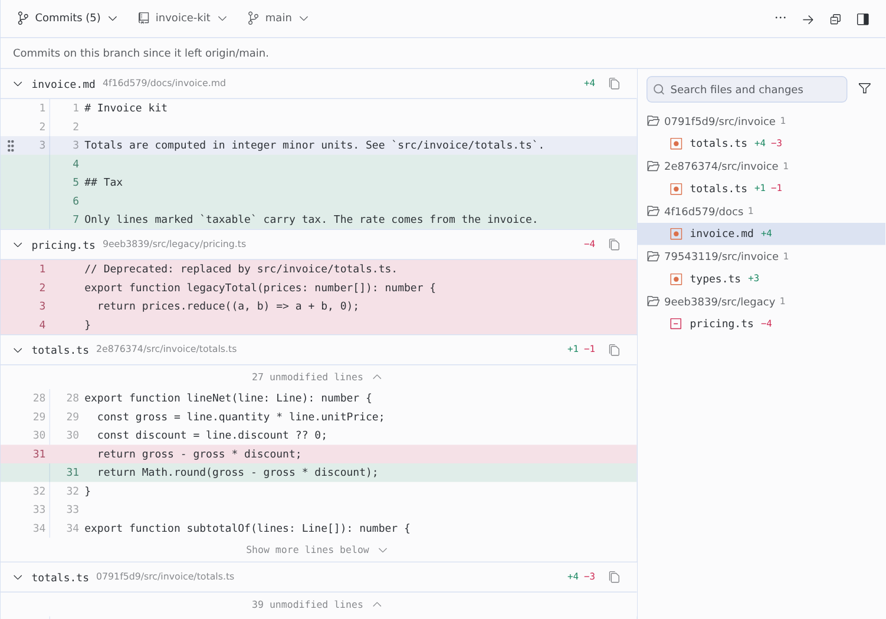
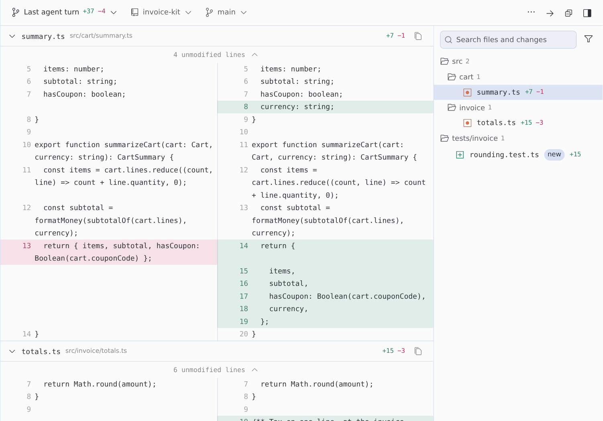
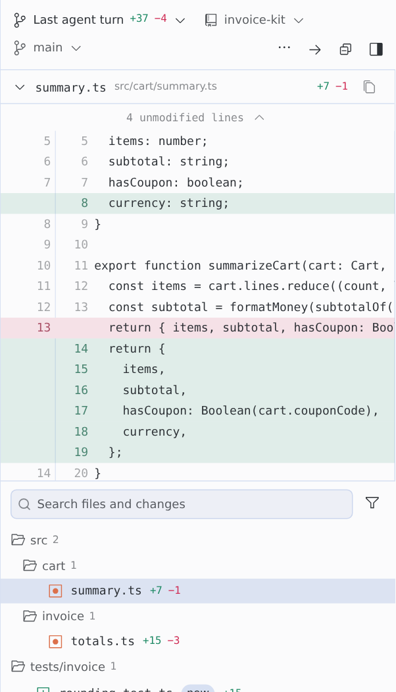
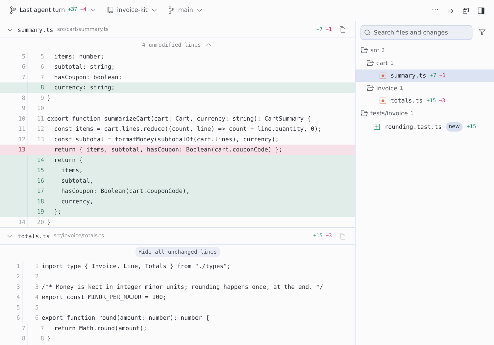
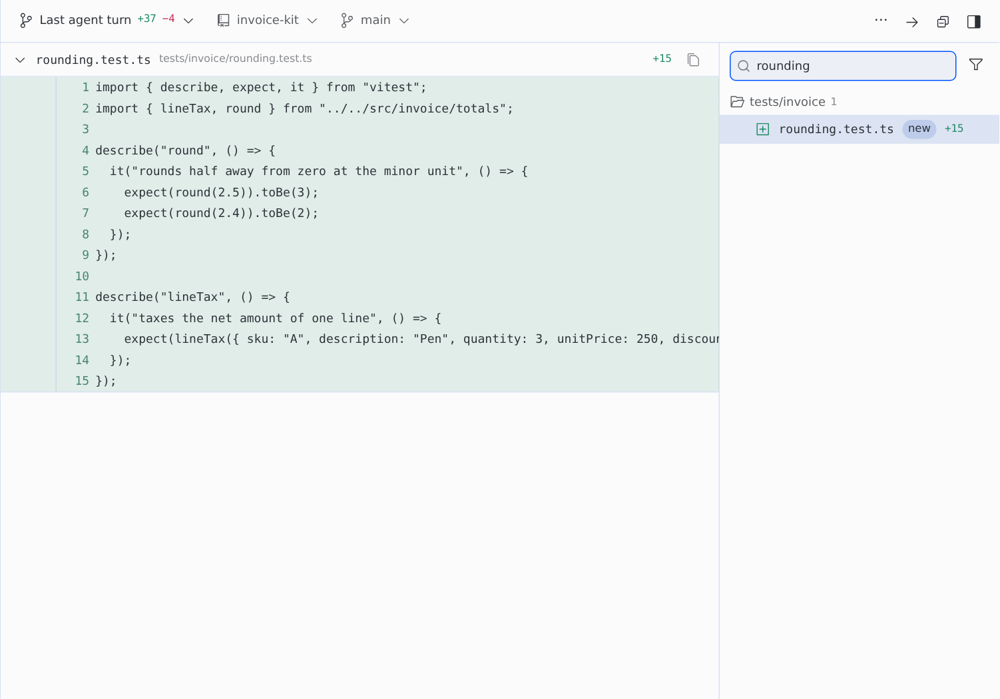
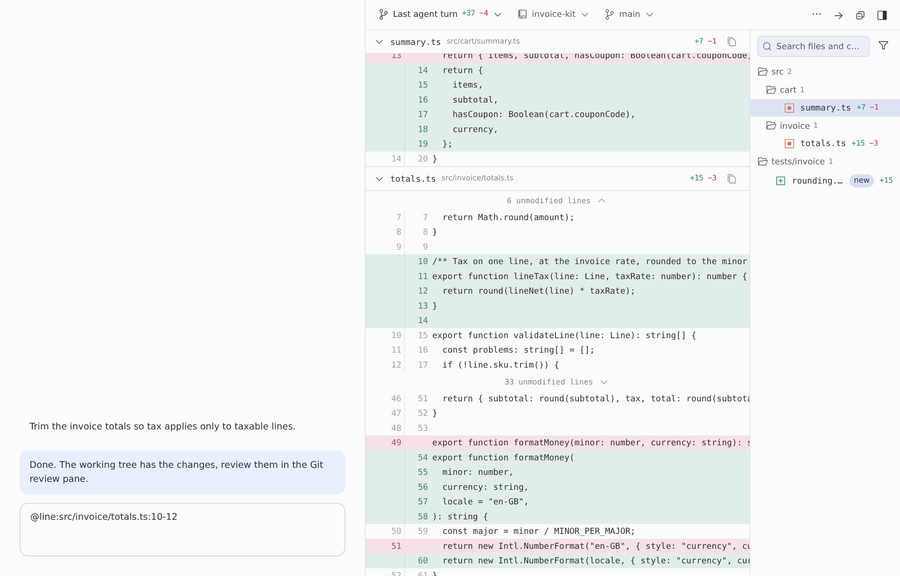
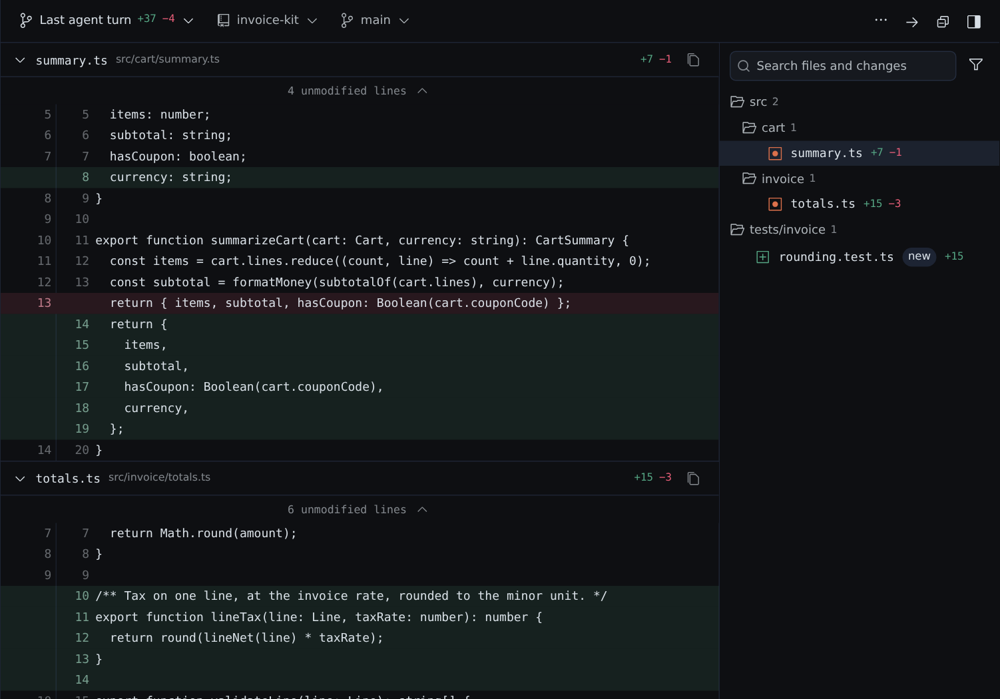

# git-review for Hermes Desktop


[](https://github.com/mister-ideas/git-review/actions/workflows/ci.yml)
[](https://github.com/mister-ideas/git-review/releases)
[](LICENSE)

**Review the whole change in one scroll, next to the chat.** git-review is a review pane for Hermes Desktop. Every changed file is stacked in one continuous diff, so you read the agent's last turn, your uncommitted or staged work, or any range of commits the way you read a pull request, in unified or split layout. Then it turns the lines you care about into `@line:` citations for your next message.



## Why it exists

An agent that edits code leaves you reviewing its work somewhere else. You switch to a terminal, rebuild what the turn touched, and lose the conversation around it. The last turn is the hardest case: part of it is committed and part is not, and no Git client groups it that way.

git-review keeps the review next to the chat and makes its result usable. Click a line, choose **Cite in message**, and the reference goes into your draft, so "this is wrong, here" costs a drag instead of a paragraph. Nothing is sent until you send it.

## See it work

The agent's turn lands in the pane as the files change. Then fold the unchanged runs, expand the context you need, and cite the lines that matter.


## Install

Requires Hermes Agent `>=0.21.6` with Desktop, and `git` on your `PATH`.

```sh
hermes plugins install mister-ideas/git-review
```

Once the plugin is in the Hermes catalog, the bare name works too: `hermes plugins install git-review`.

Hermes asks whether to install Node dependencies, because the repository declares a `package.json`. Answer **N**. That file belongs to the test tooling, and the plugin needs nothing from npm at runtime.

Then:

1. Enable **git-review** under **Capabilities → Plugins**, or run `hermes plugins enable git-review`. Desktop copies the pane from the package into `$HERMES_HOME/desktop-plugins/git-review/` and loads it.
2. Restart the backend, or quit and reopen Desktop, so the plugin's routes mount.
3. Open the pane from the command palette (**Open git review**), or toggle **Git review** in the right dock.

Cloned it yourself? `hermes plugins adopt git-review` makes the directory a tracked install, so `check-updates` and `update` work on it.

To remove it: `hermes plugins remove git-review`.

## Updating

```sh
hermes plugins check-updates          # read-only: is a newer version available?
hermes plugins update git-review
```

Restart the backend afterwards, then run **Reload desktop plugins**. If Desktop runs on a different machine from the backend, update the plugin on that machine too: the pane is copied from the package installed where the app runs.

## What it shows

Five scopes cover the ways you review work. The first control in the toolbar picks one.

| Scope | What it shows | How it is computed |
|---|---|---|
| **Last agent turn** | Everything the agent changed in this repository during its latest turn: committed and uncommitted edits, terminal edits, new files. | When the focused session becomes busy, the pane records `HEAD` and the untracked-file list. Changes are diffed against that baseline. |
| **Uncommitted** | All work not yet committed: staged, unstaged and new files. | `git status` plus the working-tree diff. |
| **Staged** | Only what is in the index. | `git diff --cached`. |
| **Unstaged** | Working-tree edits not yet staged. | `git diff` on the working tree. |
| **Commits** | The commits your branch added since it left the base (`origin/main`, for example). | Commit range since the merge base. Pick a subset, or browse one commit at a time. |

Uncommitted edits made before a turn still appear in that turn's scope. Git cannot tell who wrote a line, so the pane shows what changed since the baseline. It does not guess.



### Commits

- The list starts with every commit your branch added, all selected. **Select all** selects the whole list again after you have narrowed it, and **Load older commits** fetches more history, up to 250 commits per load.
- **Browse commit by commit** steps through one commit at a time with the Newer and Older buttons. The navigator shows the commit, its subject, author, date and position, for example `4f16d57 · Document tax handling — mister-ideas, 10/23/2026 (1/5)`. **All commits** returns to the full selection.
- The branch menu lists your local and remote branches. Pick one to show only the commits since it.
- A shallow clone has only the history it fetched, and the pane says so. Plugin installs from Hermes are shallow. To see the full history, run `git -C <plugin directory> fetch --unshallow`.





### Layouts

- **Unified** stacks every changed file, with old and new line numbers in one column.
- **Split** puts old and new side by side, with filler rows that keep the two sides aligned.
- **Narrow docks** keep the toolbar on one line and give the width to the diff.





### Folding and gaps

Unchanged runs are folded. Every change keeps three lines of context on each side, and the bar between changes says how many lines it hides, such as `29 unmodified lines`. Expand a bar to reveal up to 20 lines at a time, or all of them. Runs above the first change and below the last fold too, so the end of a file is never a dead end.



### Files

- A file tree on the right shows each file's status and churn. Folders roll up their totals.
- Search covers file paths and the changed lines themselves.
- The **Deleted files** and **Test files** filters hide what you are not looking for.
- Click a file to jump to its diff. Collapse one file, or use **Collapse all** and **Expand all**.
- **Review next file** steps through the changed files in order.
- **Copy path** copies the repository-relative path.
- Drag a file from the tree into the composer to insert its absolute path.



### Citing lines

Click a line, then another, and choose **Cite in message**. You can also press and drag across the gutter, or drag the selected lines straight into the composer. The pane writes a reference into the draft and never sends it:

```
@line:src/invoice/totals.ts:10-12
```

Lines are citable in every scope, so you can cite from the last turn, from the commits you are reviewing, or from your staged work.



### The agent can drive the pane

The agent tool `git_review_select` points the pane at a repository and scope. For example, when you ask "show me what changed in the parser", the agent can open the right view for you. It takes `repo`, `scope` (`uncommitted` by default, or `staged`, `unstaged` or `commits`), `ref` for specific commits, `base` for a range, `path` to filter to one file, and `ignore_ws`. The tool validates the request before the pane applies it.

### Pull and merge requests

If `gh` (GitHub) or `glab` (GitLab) is installed and authenticated, and the checked-out branch has an open pull or merge request, the toolbar shows a button that opens it. Without them the button is simply absent.

### Dark theme

The pane is painted only with Desktop's theme tokens, the same ones native panes use, so it follows light, dark and every skin (Catppuccin, Solarized, your own) with no colours of its own.



### What the pane remembers

Display state (layout, word wrap, ignore whitespace, the file filters, the file list's width and visibility, and which files you collapsed) is saved in Desktop plugin storage. It is keyed by profile and connection, so switching chats keeps your layout.

It deliberately does not store the scope or the repository. Those follow the focused workspace and whatever the agent asked to review, so a stale scope cannot outlive the work it described. Several chats on one workspace share one set of display settings, because a plugin cannot read the focused session id.

## git-review and the native Review pane

Hermes Desktop ships its own **Review** pane. The two answer different reading styles, and this table shows where each one is ahead. It is based on the Desktop source of Hermes core `bf0203a7`; native behaviour can change between Hermes versions.

| | **git-review** | **Native Review pane** |
|---|---|---|
| How you read a change | Every changed file stacked in one continuous scroll, like a pull request | A file tree; clicking a file opens that one file's diff below it, in a panel capped at 55% of the sidebar |
| Moving between files | Scroll, click a file to jump, or **Review next file** | Click each file in turn |
| Scopes | Last agent turn, Uncommitted, Staged, Unstaged, Commits | Uncommitted, Branch (since the trunk), Last agent turn |
| History | Pick any subset of the branch's commits, or step through them one at a time | Branch diff as a whole |
| Layout | Unified or split side by side | Unified |
| Hidden context | Gaps say how many lines they hide and expand 20 at a time or all at once | Three context lines per change, no expansion |
| Search | File paths and the changed lines themselves | — |
| Cite lines into your message | Yes, as `@line:path:start-end` | — |
| Agent can open the view | `git_review_select` tool | — |
| Syntax highlighting | Not yet | Yes (Shiki) |
| Stage, unstage, revert | Not yet | Per file or all, revert with confirmation |
| Commit, push, pull request | Not yet (opens an existing PR or MR) | Commit, commit and push, AI-drafted commit message, create or open a PR |
| Change list in the chat | — | "N files changed" card under the agent's turn |

The write actions, syntax highlighting and the in-chat card are on the roadmap: git-review is meant to cover what the native pane does, and keep its all-files-at-once reading.

## Privacy and disclosure

- **Shell commands.** The backend runs `git` as a subprocess, read-only: `rev-parse`, `status`, `diff`, `log`, `show`, `cat-file`, `ls-files`, `for-each-ref`, `branch`, `remote`, `rev-list` and `hash-object` (without `-w`, to compute the empty tree). It never fetches, checks out, stages, commits or changes repository content. External diff and textconv drivers are disabled, and every call overrides `core.fsmonitor`, `core.hooksPath` and `log.showSignature`. It also blanks the clean, smudge and process filter drivers that the repository itself defines, so a checkout cannot make the pane run its programs. Your own global filters, such as git-lfs, are left alone. Every call has a timeout and an output cap.
- **Network.** Only for the pull or merge request button. The backend runs your local `gh pr list` or `glab mr list` for the checked-out branch, so those CLIs contact GitHub or GitLab with your existing login. They get only your `GH_*`, `GITHUB*`, `GLAB_*` and `GITLAB_*` environment, with prompts disabled. The plugin itself makes no network requests.
- **Reads outside its own data.**
  - Files and history inside authorized repositories: the focused workspace, configured `repos`/`roots`, and the latest agent selection.
  - This profile's `config.yaml`, for the plugin settings and `terminal.cwd`.
  - The `cwd` column of the `sessions` table in this profile's `state.db`, opened read-only, so that recent chat workspaces appear without configuration.
  - A caller-supplied path never grants access to a repository.
- **Discovery scope.** Repositories are found by scanning, at most two levels deep, the focused workspace and the working directories of recent chats, plus any configured `repos`/`roots`. A scan visits at most 256 directories and returns at most 128 repositories. It never follows symlinks and skips hidden directories, so credential and config directories are never entered. A filesystem root is never scanned, and a home directory is scanned only when it is the declared workspace: a chat that merely ran in your home directory does not expose every repository beneath it.
- **Writes.** `$HERMES_HOME/plugin-data/git-review/select.sqlite3` holds agent selection requests. Desktop plugin storage holds display settings and turn baselines. Nothing is written to your repositories.
- **Background activity.** While the pane is open it polls the local backend: every 3 seconds for agent selections, and every 5 seconds for the diff on live scopes. There are no background processes.
- **Credentials and telemetry.** None. The plugin stores no credentials and reports no usage.
- **Sensitive code.** Diffs stay in the pane. The only way code reaches the chat is a citation or drag that you make yourself.

## Limits

- Diffs above 8 MiB are refused with a note rather than silently truncated.
- The commit list fetches up to 250 commits per request. **Load older commits** fetches more, so no history is unreachable.
- Each unchanged-line expansion reads at most 5,000 lines.
- Untracked files in a turn diff are capped at 200.
- Display state is per workspace and profile, not per chat (see [What the pane remembers](#what-the-pane-remembers)).
- Syntax highlighting is not implemented yet.
- The screenshots and videos here were captured from the plugin's own code, running against a real backend and real repositories, in a Chromium harness that stands in for the Desktop window. They are not captures of the Desktop app itself.

## Settings

The pane follows the focused chat's workspace automatically. To offer other repositories, open **Settings → Plugins → git-review**:

| Setting | Meaning |
|---|---|
| `repos` | Newline-separated absolute repository paths. |
| `roots` | Newline-separated absolute directories to scan for worktrees (two levels deep, at most 256 directories). |

Settings live under `plugins.entries.git-review.settings`. None of them are secrets.

## Troubleshooting

| Symptom | Check |
|---|---|
| No worktrees found / HTTP 403 | Open a chat whose workspace is a Git repository, or configure `repos`/`roots`. |
| Backend unavailable | Make sure the plugin is enabled and the backend is running. Backend updates need a backend restart. |
| Diff exceeds display limit | Narrow the scope, the selected commits or the file filter. |
| Pull/merge request button missing | Authenticate `gh`/`glab` and check that the branch has an open pull or merge request. |
| Pane missing or stale | Enable the plugin, then run **Reload desktop plugins** from the command palette. If Desktop runs on another machine than the backend, install the plugin on that machine too. |
| Commits list shows only a few commits | The reviewed repository is a shallow clone (a plugin directory installed by Hermes is one). Run `git fetch --unshallow` in that repository. |

## Development

```sh
npm ci
npm test                 # unit, smoke and import-allowlist checks
python -m unittest discover -s tests -v
hermes plugins validate . --install-deps
python scripts/package.py
```

Python tests run against temporary real repositories and the actual FastAPI router. The Node tests render the real pane with test doubles for the Desktop SDK.

See [CONTRIBUTING.md](CONTRIBUTING.md) and [SECURITY.md](SECURITY.md). Changelog: [CHANGELOG.md](CHANGELOG.md).

## Support, issues and releases

- Bugs and feature requests: the [issue forms](https://github.com/mister-ideas/git-review/issues/new/choose). The bug form asks for your versions, the scope you had selected and the `git-review` log lines. That evidence is what makes a report reproducible.
- Questions and ideas: [Discussions](https://github.com/mister-ideas/git-review/discussions).
- Security: [SECURITY.md](SECURITY.md). Report privately, never in a public issue.
- Community expectations: [CODE_OF_CONDUCT.md](CODE_OF_CONDUCT.md).
- Contributing: [CONTRIBUTING.md](CONTRIBUTING.md) explains what is in and out of scope, and how releases are cut.

Releases are SemVer tags with a GitHub Release. The release workflow builds each zip only after the test suite passes, and published releases are immutable. The Hermes plugin catalog pins an exact commit, and moving that pin is a reviewed pull request against `NousResearch/hermes-agent`, so catalog users only receive reviewed code.

## License

MIT. See [LICENSE](LICENSE).
