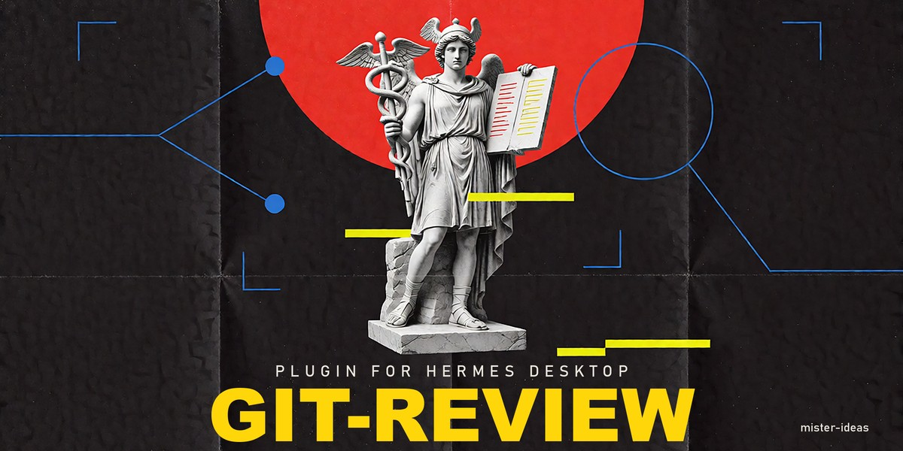
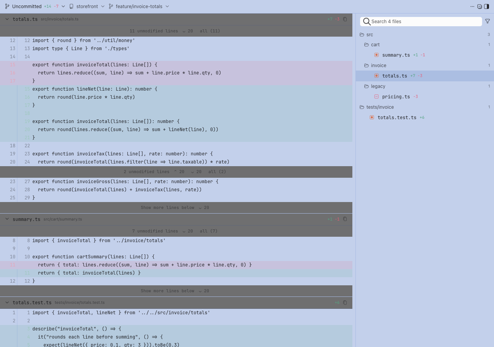
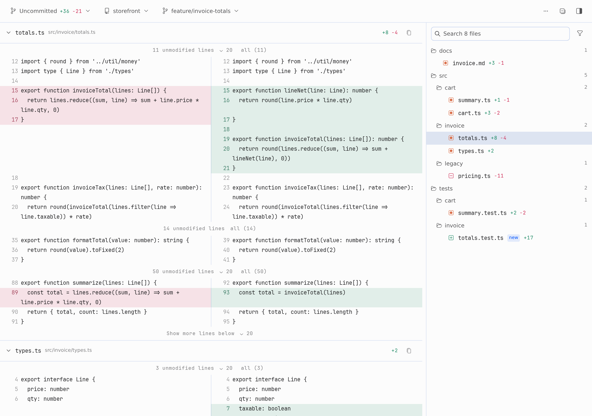
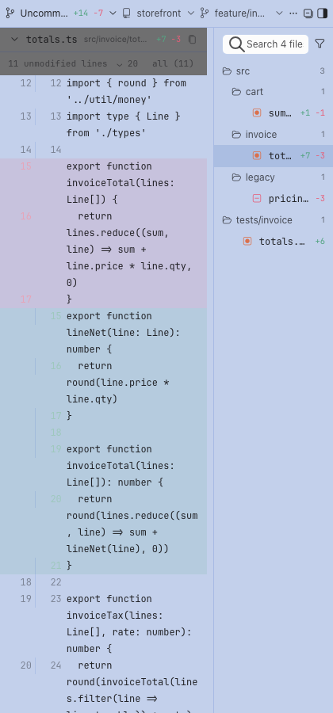
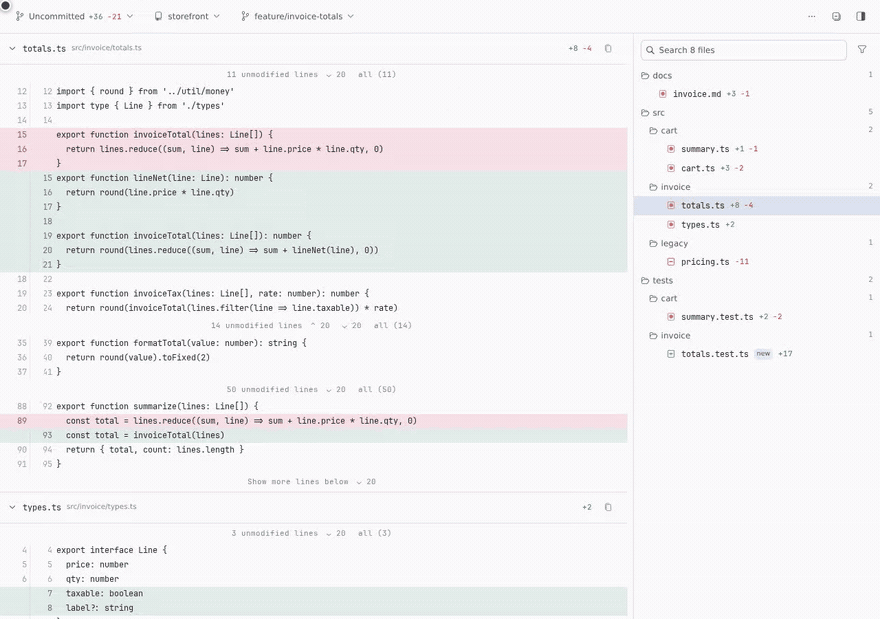

# git-review for Hermes Desktop



[](https://github.com/mister-ideas/git-review/actions/workflows/ci.yml)
[](https://github.com/mister-ideas/git-review/releases)
[](LICENSE)

Author: **mister-ideas**. MIT-licensed Hermes native plugin.

A read-only Git review pane for Hermes Desktop. It shows what changed in the repository you are working in — the agent's last turn, uncommitted, staged or unstaged work, or any selection of commits — in unified or split layout, and lets you cite changed lines into the chat composer. It depends on nothing beyond Hermes itself and `git`.



## Why this exists

An agent that edits code leaves you reviewing the diff somewhere else: you switch
to a terminal, reconstruct what the turn touched, and lose the conversation's
context. The last turn is the hardest case — it is committed and uncommitted at
once, and no Git client groups it that way.

This pane puts that review where the work happened, and makes the result usable:
the same changed lines go back into the draft as `@line:` citations, so "this is
wrong, here" costs a drag instead of a paragraph.

**What it is not.** It is read-only by design — it never fetches, stages, commits
or checks out, so it cannot fix anything for you. It also cannot attribute edits
it did not observe: uncommitted work that predates the turn still appears in the
turn scope, because Git cannot say who wrote it.

## What it looks like

Unified layout — every changed file stacked, unchanged runs folded away. Split
layout — the same diff side by side, word wrap always on. Narrow docks keep the
toolbar on one line and hand the width to the diff.

| Split | Narrow |
|---|---|
|  |  |

## Watch it work

The agent points the pane at a scope, and the pane follows:


Fold the unchanged runs, then expand the lines outside the patch:



Cite the lines that matter straight into the draft:


## Requirements

- Hermes Agent `>=0.21.6` with Desktop.
- `git` on `PATH`.
- Optional: an authenticated `gh` (GitHub) or `glab` (GitLab) CLI, for the pull/merge request badge.

## Install

`hermes plugins install` takes a catalog name, a Git URL or `owner/repo`, and `--ref` pins one exact commit. To install straight from this repository:

```sh
hermes plugins install mister-ideas/git-review
```

Once the plugin is listed in the Hermes catalog, the bare name works too:

```sh
hermes plugins install git-review
```

Cloned it yourself? `hermes plugins adopt git-review` reads the directory's git
origin and makes it a tracked install, so `check-updates` and `update` work on it.

Hermes asks "declares Node dependencies (package.json)" during install. Answer **N**: the `package.json` in this repository belongs to the test tooling, and the plugin needs no Node packages at runtime.

Then:

1. Enable **git-review** under **Capabilities → Plugins** (or `hermes plugins enable git-review`). The Desktop app copies the pane from the package's `desktop/` folder into `$HERMES_HOME/desktop-plugins/git-review/` and hot-loads it.
2. Restart the backend — or quit and reopen the app — so the plugin's routes mount.
3. Open it from the command palette (**Open git review**), or toggle the **Git review** pane, which docks right by default.

To remove it:

```sh
hermes plugins remove git-review
```

## Updating

```sh
hermes plugins check-updates          # read-only: is a newer version available?
hermes plugins update git-review
```

Restart the backend afterwards (new routes mount at start) and run **Reload desktop plugins**. If Desktop runs on a different machine than the backend, run the install or update there too: the pane is copied from the installed package on the machine that runs the app.

## What happens on first install

- The pane follows the focused chat's workspace. If that workspace is not a Git
  repository, the pane says so instead of guessing.
- Nothing is blocked, rewritten or staged. Only the focused repository is read,
  plus anything you configure under `repos`/`roots`.
- `gh`/`glab` are optional: without them the PR badge is simply absent, and the
  rest of the pane works.
- The agent tool `git_review_select` is registered, so a chat can point the pane
  at a repository and scope.
- **Confirm it loaded:** **Capabilities → Plugins** lists **git-review**, and the
  command palette offers **Open git review**.
- New backend routes only answer after a backend restart; the desktop half
  hot-reloads as soon as the app copies it.

## What it does

- **Scopes:** Last agent turn · Uncommitted · Staged · Unstaged · Commits.
- **Commits** lists the commits your branch has added since it left the default branch (`origin/main`, for example), all checked by default. The Commits menu switches to **Whole history of this branch** and pages older commits in on demand; pick any subset, or **Browse commit by commit** with ◀ ▶. The branch menu lists your local and remote branches: pick one to list only the commits since it. A shallow clone has only the history it fetched, and the pane says so.
- **Last agent turn** shows everything since the agent's current turn began in this repo, committed and uncommitted, terminal edits and new files included. When the focused session goes busy, the pane snapshots `HEAD` and the untracked file list, then diffs against that baseline. Uncommitted edits that predate the turn still appear, because Git cannot attribute them.
- **Diffs:** unified or split layout (split always wraps), whitespace filtering, and folding of unchanged lines: every change keeps three lines of context, and the bars between changes count the lines actually hidden, revealing up to 20 at a time or all of them, including above the first change and below the last when the file continues.
- **Files:** a right-hand tree with per-file churn, file search, and Deleted / Test filters. Click a file to jump to it; drag a file into the composer to attach it.
- **Line citations:** click a line, then another, and choose **Cite in message** to insert an `@line:` reference into the focused composer draft, or drag lines into the composer. Only lines that exist in the current working tree can be cited (Last agent turn, Uncommitted and Unstaged scopes). Nothing is ever sent automatically.
- **Agent tool `git_review_select`:** lets the agent point the pane at a repository and scope (`repo`, `scope`, `ref`, `base`, `path`, `ignore_ws`). It validates the diff first, then queues the selection for the pane.

## Using the pane

1. **Pick a change set** with the toolbar's first control: Last agent turn, Uncommitted, Staged, Unstaged or Commits.
2. **Read it.** Reveal hidden lines a bar at a time, or open a whole file with **all**; switch to split, filter whitespace, or search and filter the file tree.
3. **Cite what matters.** Click a line, then another, and choose **Cite in message** — or drag the lines straight into the composer. The pane inserts a reference into the draft and never sends it:

   ```
   @line:src/invoice/totals.ts:15-21
   ```

## Configuration

The pane follows the focused chat's workspace automatically. To offer other repositories, open Settings → Plugins → git-review:

| Setting | Meaning |
|---|---|
| `repos` | Newline-separated absolute repository paths. |
| `roots` | Newline-separated absolute directories to scan for worktrees (two levels deep, at most 256 directories). |

Settings are stored under `plugins.entries.git-review.settings`. None of them are secrets.

### What the pane remembers

Display state — layout, word wrap, ignore whitespace, the deleted/test filters, the file list's visibility and width, and which files you collapsed — is kept in desktop plugin storage, keyed by **profile + connection + focused workspace**. Come back to a workspace and the pane is as you left it.

Two things it deliberately does not store:

- **The scope and the repository.** They follow the focused workspace and what the agent asked to review, so a stale scope cannot outlive the work it described.
- **Anything per chat session.** A desktop plugin is not given the focused session id — the loader's allowlist exposes no such atom, and the smoke harness rejects the import — so several chats on the same workspace share one set of pane settings. That is the closest a plugin can get to "per session"; separate state per chat is not something the plugin API allows today.

A workspace with no saved state yet starts from the settings the pre-0.1.16 versions wrote, so upgrading does not reset a pane you had already tuned.

## Privacy and disclosure

- **Shell commands.** The backend runs `git` as a subprocess, read-only: `rev-parse`, `status`, `diff`, `log`, `show`, `cat-file`, `ls-files`, `for-each-ref`, `branch`, `remote`, `rev-list` and `hash-object` (without `-w`, to compute the empty tree). It never fetches, checks out, stages, commits or changes repository content. External diff and textconv drivers are disabled, and every call overrides `core.fsmonitor`, `core.hooksPath` and `log.showSignature` and blanks the clean, smudge and process filter drivers that the repository itself defines, so a checkout cannot make the pane run its programs. Your own global filters, such as git-lfs, are left alone. Every call has a timeout and an output cap.
- **Network.** Only for the PR/MR badge. The backend runs your local `gh pr list` or `glab mr list` for the checked-out branch, so those CLIs contact GitHub or GitLab with your existing login. They get only your `GH_*`, `GITHUB*`, `GLAB_*` and `GITLAB_*` environment, with prompts disabled. The plugin itself makes no network requests.
- **Reads outside its own data.**
  - Files and history inside authorized repositories: the focused workspace, configured `repos`/`roots`, and the latest agent selection.
  - This profile's `config.yaml`, for the plugin settings and `terminal.cwd`.
  - The `cwd` column of the `sessions` table in this profile's `state.db`, opened read-only, so that recent chat workspaces appear without configuration.
  - A caller-supplied path never grants access to a repository.
- **Discovery scope.** Repositories are found by scanning, at most two levels deep, the focused workspace and the working directories of recent chats, plus any configured `repos`/`roots`. A scan visits at most 256 directories and returns at most 128 repositories, never follows symlinks, and skips hidden directories, so credential and config directories are never entered. A filesystem root is never scanned, and a home directory is scanned only when it is the declared workspace: a chat that merely ran in your home directory does not expose every repository beneath it.
- **Writes.** `$HERMES_HOME/plugin-data/git-review/select.sqlite3` holds agent selection requests. Desktop plugin storage holds display settings and turn baselines. Nothing is written to your repositories.
- **Background activity.** While the pane is open it polls the local backend: every 3 s for agent selections, and every 5 s for the diff on live scopes. There are no background processes.
- **Credentials and telemetry.** None. The plugin stores no credentials and reports no usage.
- **Sensitive code.** Diffs stay in the pane. The only way code reaches the chat is a citation or drag that you make yourself.

## Limits

- Diffs above 8 MiB are refused with a note rather than silently truncated.
- The commit list loads 250 commits at a time; **Load older commits** pages further back, so no history is unreachable.
- Each unchanged-line expansion reads at most 5,000 lines.
- New untracked files in a turn diff are capped at 200.
- Pane display state is per workspace, not per chat: several chats on one workspace share it (see [What the pane remembers](#what-the-pane-remembers)).

## Troubleshooting

| Symptom | Check |
|---|---|
| No worktrees found / HTTP 403 | Open a chat whose workspace is a Git repository, or configure `repos`/`roots`. |
| Backend unavailable | Make sure the plugin is enabled and the backend is running. Backend updates need a backend restart. |
| Diff exceeds display limit | Narrow the scope, the selected commits or the file filter. |
| PR button missing | Authenticate `gh`/`glab` and check that the branch has an open PR/MR. |
| Pane missing or stale | Enable the plugin, then run **Reload desktop plugins** from the command palette. Desktop on another machine than the backend: install the plugin on that machine too. |
| Commits lists only a few commits | The reviewed repository is a shallow clone (a plugin directory installed by Hermes is one). The pane says so; run `git fetch --unshallow` in that repository. |

## Development

```sh
npm ci
npm test                 # unit, smoke and import-allowlist checks
python -m unittest discover -s tests -v
hermes plugins validate . --install-deps
python scripts/package.py
```

Python tests use temporary real repositories and the actual FastAPI router.

See [CONTRIBUTING.md](CONTRIBUTING.md) and [SECURITY.md](SECURITY.md). Changelog: [CHANGELOG.md](CHANGELOG.md).

## Support, issues and releases

- Bugs and feature requests: the [issue forms](https://github.com/mister-ideas/git-review/issues/new/choose). The bug form asks for your versions, the scope you had selected and the `git-review` log lines — that evidence is what makes a report reproducible.
- Questions and ideas: [Discussions](https://github.com/mister-ideas/git-review/discussions).
- Security: [SECURITY.md](SECURITY.md) — reported privately, never in a public issue.
- Community expectations: [CODE_OF_CONDUCT.md](CODE_OF_CONDUCT.md).
- Contributing: [CONTRIBUTING.md](CONTRIBUTING.md) — what is in and out of scope, and how releases are cut.

Releases are SemVer tags with a GitHub Release whose zip the release workflow builds only after the suite passes. There is no fixed cadence: fixes ship when they are ready. The Hermes plugin catalog pins an exact commit SHA, and moving that pin is a reviewed pull request against `NousResearch/hermes-agent`, so catalog users only ever receive reviewed code.

## License

MIT — see [LICENSE](LICENSE).
